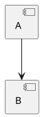

# Maven dependency graph: variant 11

Practical work 2, stages 1-5. The application reads settings from CSV,
builds a graph using recursive BFS, calculates dependency-first loading
order, and prints a PlantUML diagram description.

## Requirements

Python 3.10 or later. No third-party packages or compilation are needed.

## Configuration

The chosen CSV layout has two columns with the header `key,value`:

```csv
key,value
package,junit:junit
version,4.13.2
repository,https://repo.maven.apache.org/maven2
test_mode,false
```

The assignment requires the four settings; the column names and layout
are the representation chosen for this program.

| Setting | Meaning |
|---|---|
| `package` | Name of the package to analyze. |
| `version` | Version of the package to analyze. |
| `repository` | Repository URL or path to a test repository file. |
| `test_mode` | `true` for a local file, `false` for a real repository. |

All four settings must be present and nonempty. Mode must be `true` or
`false`. In real mode, the repository URL must have a scheme and
hostname. In test mode, the repository must be an existing file; relative
paths are interpreted against the CSV directory.

In real mode, `package` identifies a Maven artifact as `groupId:artifactId`.
The package version is used in the requested POM URL. Package and version
values have no additional regular-expression restrictions. Missing packages
or versions produce a repository request error.

## Stage 2

For `junit:junit`, version `4.13.2`, the application requests:

```text
https://repo.maven.apache.org/maven2/junit/junit/4.13.2/junit-4.13.2.pom
```

Dots in groupId become slashes. The POM is downloaded with Python's standard
`urllib.request` and parsed with `xml.etree.ElementTree`. No package manager
or third-party dependency library is used. No JAR files are downloaded.

Only the project's own `dependencies` section is read. Entries inside
`dependencyManagement`, build plugins, or profiles are not treated as direct
declarations. All scopes in the direct section are included, including test
dependencies. Each dependency now includes its version, because stage 3
must request the correct POM for each discovered package.

This is a simple POM reader, not a complete Maven effective-model resolver:
parent inheritance and dependency-management resolution are not implemented.
Properties from the same POM and the supplied project's version/group/name
are substituted. Missing versions or unresolved properties produce an error
rather than guessing a version. A full effective-model implementation is
outside this simple reader.

Example output with the supplied configuration:

```text
Dependency graph:
junit:junit:4.13.2 -> org.hamcrest:hamcrest-core:1.3, org.hamcrest:hamcrest-library:1.3
org.hamcrest:hamcrest-core:1.3 -> (none)
org.hamcrest:hamcrest-library:1.3 -> org.hamcrest:hamcrest-core:1.3
```

Packages with no dependencies are printed with `(none)`. Network, POM, and
graph input errors print `Dependency loading error: ...`.

## Stage 3

The graph is a dictionary: a package key maps to its direct dependencies.
Only packages reachable from the configured starting package are included.
Real Maven keys use `groupId:artifactId:version`, preserving the version
of each dependency rather than reusing the starting package's version.

`bfs` processes all packages of the current level, collects the next level,
and recursively calls itself for that next level. A `visited` set records
packages when they are first scheduled. Shared and cyclic dependencies are
not scheduled again, but their graph edges are preserved.

Test mode reads the configured local JSON file instead of a remote Maven
repository. The chosen file representation is:

```json
{
    "A": ["B", "C"],
    "B": ["D"],
    "C": ["D"],
    "D": []
}
```

Each key is an uppercase Latin package name. Its value is a list of direct
dependency names; referenced packages must also have entries. The version
setting is retained in CSV but test graph nodes are identified by letters,
as required by the assignment. The JSON layout is our representation;
the assignment does not specify the format of the local graph file.

For a cycle `A -> B -> C -> A`, all three edges are printed and traversal
finishes. The optional loading-order mode reports that cycles prevent an
order. PlantUML mode preserves and displays cyclic connections.

## Stage 4

Use `--order` to print loading order instead of the graph. A package is
placed after all of its dependencies; the selected root package is included
at the end. Independent packages can have several equally valid orders.
This program uses the graph's existing order to break ties.

`loading_order` repeatedly selects packages whose dependencies are already
in the result. If unprocessed packages remain but none can be selected,
there is a cycle and the program reports an error without printing a partial
order. The input graph is not modified.

Examples: chain `A -> B -> C` gives `C -> B -> A`; the shared-dependency
example gives `D -> B -> C -> A`. A cycle has no dependency-first order.

The assignment does not define a physical network download sequence. The
implemented order means dependencies before dependents; it is not a claim
about JVM class loading, Maven download scheduling, or classpath precedence.
See [the Maven comparison](tests/MAVEN_COMPARISON.md) for measured output
and the explanation of differences.

## Stage 5

Use `--plantuml` to print the graph as PlantUML text. Output starts with
`@startuml` and ends with `@enduml`; there is no extra graph heading. Each
package has a quoted component label and a short alias such as `P0`.
Dependencies become arrows between aliases. Explicit component declarations
preserve packages with no dependencies. Shared nodes are declared once.

Example for `A -> B`:



`--plantuml` and `--order` are separate output modes and cannot be used
together. Neither requires a new CSV setting. Without either option, the
program continues to print the text graph.

[Three rendered examples and Maven comparisons](examples/README.md) include
JUnit 4.13.2, Hamcrest Library 1.3, and Hamcrest Core 1.3. Each example has
its CSV settings, generated `.puml`, and rendered `.svg`, plus native Maven
DOT and its SVG rendering. SVGs are the required demonstration results;
renderer binaries, downloaded JARs, caches, and PNG checks are not committed.

The application itself only prints PlantUML and uses the Python standard
library. PlantUML/Java are needed only to turn its text into an image.

## Run

From the repository root:

```powershell
python -B DependencyGraph/src/main.py
.\DependencyGraph\run.bat
python -B DependencyGraph/src/main.py --config DependencyGraph/tests/config_test.csv
python -B DependencyGraph/src/main.py --config DependencyGraph/tests/config_shared.csv --order
python -B DependencyGraph/src/main.py --plantuml
```

By default the program reads `DependencyGraph/config.csv`. The optional
`--config` argument selects another CSV. All analysis settings come from
that file.

Configuration errors are reported as `Configuration error: ...`. Exit code
0 means success; exit code 1 means a configuration, dependency-load, or
loading-order error. Without `--order`, the graph output is unchanged.

## Functions

| Function | Purpose |
|---|---|
| `read_config(path)` | Read the two-column CSV into a dictionary. |
| `validate_config(config, config_path)` | Check the four settings. |
| `get_dependencies(package, version, repository)` | Download and read direct POM dependencies. |
| `resolve_value(value, properties)` | Substitute property references in a POM value. |
| `read_test_repository(path)` | Read the uppercase-name JSON test graph. |
| `bfs(level, graph, visited, config, repository)` | Recursively process BFS levels. |
| `build_graph(config, config_path)` | Select the source and collect the reachable graph. |
| `print_graph(graph)` | Print package-to-dependency connections. |
| `loading_order(graph)` | Put dependencies before dependents, or report a cycle. |
| `to_plantuml(graph)` | Convert graph nodes and edges to PlantUML text. |
| `print_result(graph, args)` | Select graph, loading-order, or PlantUML output. |
| `main()` | Read, validate, print, and handle errors. |

## Demonstration and tests

```powershell
.\DependencyGraph\tests\test_stage1.ps1
.\DependencyGraph\tests\test_stage2.ps1
.\DependencyGraph\tests\test_stage3.ps1
.\DependencyGraph\tests\test_stage4.ps1
.\DependencyGraph\tests\test_stage5.ps1
python -B -m unittest discover -s DependencyGraph/tests -p 'test_*.py' -v
```

The stage 2 demonstration now downloads the graph selected in `config.csv`.
The stage 1 script still checks configuration errors, using the current
program version. Automated tests cover configuration errors, URL assembly
for the requested version, direct-section parsing, empty dependencies, XML
errors, and network errors. Automated tests replace HTTP responses with
small XML examples. The stage 3 demonstration uses local files for a single
package, a chain, a shared dependency, and a cycle. It needs no network.

```powershell
python -B DependencyGraph/src/main.py --config DependencyGraph/tests/config_shared.csv
python -B DependencyGraph/src/main.py --config DependencyGraph/tests/config_cycle.csv
```

Stage 4 tests cover the single package, chain, shared dependency, cycle,
self-cycle, and a cycle mixed with an independent package. The demonstration
script expects the cyclic case to fail. Maven is used only by the separate
comparison script; the Python program never invokes a package manager.

Stage 5 tests cover isolated/shared nodes, cycles, Maven names, clean CLI
PlantUML output, and incompatible output options. `test_stage5.ps1` prints
PlantUML for all three real-package examples and needs network access.

Ready `.puml` and `.svg` examples are in `examples`. Trial rendering and
comparison caches should be kept outside the repository.
