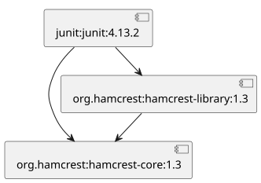
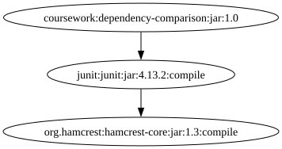
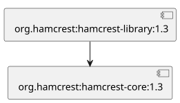
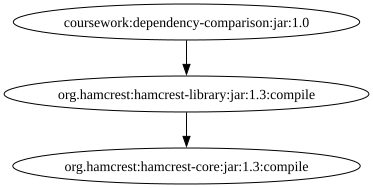
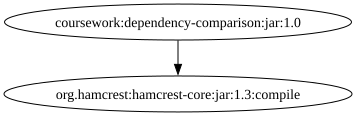

# Stage 5: diagrams and Maven comparison

Three different Maven packages were checked on 2026-11-12. PlantUML sources
were generated by the Python application and rendered by PlantUML 1.2025.2.
Native Maven DOT files were produced by Maven Dependency Plugin 3.8.1
`dependency:tree` and rendered by Graphviz 12.2.1.

## JUnit 4.13.2

| Our PlantUML graph | Native Maven graph |
|---|---|
|  |  |

Sources: [CSV](junit.csv), [PlantUML](junit.puml), [Maven DOT](junit_maven.dot).

## Hamcrest Library 1.3

| Our PlantUML graph | Native Maven graph |
|---|---|
|  |  |

Sources: [CSV](hamcrest_library.csv), [PlantUML](hamcrest_library.puml),
[Maven DOT](hamcrest_library_maven.dot).

## Hamcrest Core 1.3

| Our PlantUML graph | Native Maven graph |
|---|---|
|  |  |

Sources: [CSV](hamcrest_core.csv), [PlantUML](hamcrest_core.puml),
[Maven DOT](hamcrest_core_maven.dot).

## Comparison

Maven was run on a small comparison project that declares the selected
package as a dependency. Its diagram therefore has an extra
`coursework:dependency-comparison:jar:1.0` root. This root is not part of
the selected package and is excluded from the counts below.

| Selected package | Our nodes / edges | Maven subtree nodes / edges |
|---|---|---|
| JUnit | 3 / 3 | 2 / 1 |
| Hamcrest Library | 2 / 1 | 2 / 1 |
| Hamcrest Core | 1 / 0 | 1 / 0 |

Hamcrest Library and Hamcrest Core have matching package connections.
Hamcrest Core has no dependencies; its isolated vertex is still rendered.

The JUnit diagrams differ because its POM declares Hamcrest Library with
`test` scope. Our simple reader includes every direct declaration. Maven
does not propagate that test dependency to a project using JUnit. The
remaining JUnit-to-Hamcrest-Core dependency agrees. Maven also shows artifact
type and scope in its labels; our labels contain package and version only.
Node positions and shapes are renderer choices, not dependency differences.

This comparison does not change the existing limitation of the Maven reader:
it is not a full effective-POM resolver with parent/BOM inheritance.

## Demonstrate

From the repository root:

```powershell
.\DependencyGraph\tests\test_stage5.ps1
python -B DependencyGraph/src/main.py --config DependencyGraph/examples/junit.csv --plantuml
```

Open the `.svg` files in a browser to view the ready diagrams. The `.puml`
files are also valid inputs for PlantUML. The Python application needs only
the standard library; image rendering is a separate demonstration step.

To reproduce native Maven output, set `JAVA_HOME`, then run:

```powershell
$scratch = Join-Path $env:USERPROFILE 'Documents\CodexScratch\tasks'
$work = Join-Path $scratch '2026-11-12-dependencygraph-stage5\comparison'
.\DependencyGraph\tests\compare_visualization.ps1 -WorkDir $work -Maven mvn
```

If Maven is not on PATH, pass its full `mvn.cmd` path. The optional
`-Repository` parameter allows reusing an existing Maven cache outside the
project. Full Maven logs and build/cache files remain in CodexScratch.

Tool references:
- [PlantUML components](https://plantuml.com/component-diagram)
- [Maven dependency tree formats](https://maven.apache.org/plugins/maven-dependency-plugin/tree-mojo.html)
